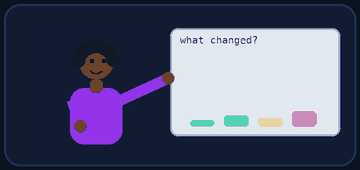
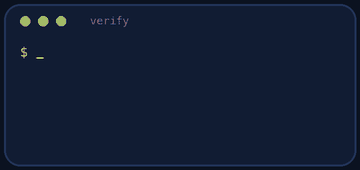
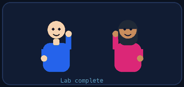

<p align="center"></p>

| | |
|-|-|
| **Time** | 60-75 min |
| **Cost** | free |
| **You need** | Git and bash in your Ubuntu environment |

## How this lab works

1. **Fork** this repository to your own GitHub account (button at the top right).
2. Clone **your fork** in your Ubuntu environment (WSL on Windows, your OrbStack machine on Mac).
3. Read the lab below (the same text is in [`LAB.md`](LAB.md)) and follow the mission.
4. Answer the questions in [`SUBMISSION.md`](SUBMISSION.md). Where a question asks for output, paste it in a code block. No screenshots needed.
5. Commit and push. Open the **Actions** tab of your fork (click *I understand my workflows, go ahead and enable them* the first time). The **Lab check** shows what is still missing.
6. When the check is green, **submit the URL of your fork** in the course platform.

> [!NOTE]
> The check only looks at your answers and any files the lab asks you to commit. Your instructor reads your work and may ask you to explain any line.

<p align="center"></p>

## 🎬 The situation

<p align="center"></p>

Monday, stand-up. The product owner asks: *"What exactly changed since the last release? Is it a patch, a minor or a major? Customers are asking."* Nobody can answer. The commit log says `wip`, `fix stuff` and `update`. Someone has to read 200 commits to write the release notes by hand, every release.

You will fix this for good: commit messages with a **rule**, release notes **generated from history**, and a version number **computed, not argued about**.

> [!IMPORTANT]
> **Your mission**
> - Learn the Conventional Commits format by reading real history
> - Block bad commit messages automatically with a **commit-msg hook**
> - Write `changelog.sh` that builds release notes from commits since the last tag
> - Write `next-version.sh` that decides the next semantic version
> - Clean up a messy branch without losing a single commit

**Time:** 60-75 min | **Cost:** free | **You need:** Git and bash in your Ubuntu environment

<p align="center"></p>

## Part 0 - Set the scene

Fork this repository, clone your fork, and run:

```bash
./setup.sh
```

It creates a Clipstr repository with a realistic history in `sandbox/clipstr` (ignored by Git, it is your playground). The last release is tagged `v1.2.0`; the commits after it are the unreleased work.

<p align="center"></p>

## Part 1 - Recon: read the history

<p align="center"></p>

```bash
cd sandbox/clipstr
git log --oneline v1.2.0..HEAD
git tag -n
```

1. Which commits follow the pattern `type(scope): subject`? Which do not?
2. Write down, for **each** unreleased commit, what kind of change you think it is (new feature, bug fix, docs, chore...) and whether a customer would notice it.
3. Which one would break existing users of the API? How could you tell from its message?
4. Read the Conventional Commits rules in the lesson or at `conventionalcommits.org`. In one sentence each: what do `feat`, `fix`, `!` and a `BREAKING CHANGE:` footer mean for the version number?

> [!NOTE]
> **Predict** If you released today, which version would it be: 1.2.1, 1.3.0 or 2.0.0? Write your prediction. You will check it with your own script later.

<p align="center"></p>

## Part 2 - Build the gatekeeper: a commit-msg hook

Git runs `.git/hooks/commit-msg` with the path of the message file as its first argument. If the script exits non-zero, the commit is rejected.

Create `hooks/commit-msg` in **this lab repo** (not inside the sandbox), make it executable, and make it enforce:

- first line matches `type(scope)?!?: subject`
- types: `feat fix docs style refactor perf test build ci chore revert`
- the type is lowercase, a space follows the colon, the subject has at least 3 characters and the line at most 72
- merge commits are allowed
- when it rejects, print **what was expected and what it got**, to standard error

Test the script by hand with a message file before wiring it:

```bash
echo "fixed stuff" > /tmp/m && hooks/commit-msg /tmp/m; echo "exit code: $?"
```

Then switch it on in the sandbox repository only:

```bash
git -C sandbox/clipstr config core.hooksPath "$PWD/hooks"
```

> [!WARNING]
> **Break it** In the sandbox, try `git commit --allow-empty -m "fixed stuff"`. Read your own error message. Then try `git commit --allow-empty -m "chore: try the hook"` and see it pass. Is the error message good enough for a tired colleague at 18:00? Improve it.

> [!NOTE]
> **Think** A hook lives on one machine. How would a whole team get the same hook, and what would still let someone skip it (`--no-verify`)? What would you add on the server side?

<p align="center"></p>

## Part 3 - Release notes without a human: changelog.sh

Write `changelog.sh` (run from the lab repo; it takes an optional path argument and defaults to `sandbox/clipstr`). It must:

- find the **last tag** by itself (`git describe --tags --abbrev=0`)
- read the commit subjects since that tag
- print a Markdown changelog with sections **BREAKING CHANGES**, **Features** and **Bug Fixes**, showing the subject **without** the `type(scope):` prefix
- leave out `docs`, `chore`, `wip` and anything that does not follow the format
- skip a section when it has no entries

Run it. Does the output match what you wrote down in Part 1?

<p align="center"></p>

## Part 4 - The version number is a function: next-version.sh

Write `next-version.sh` (same path convention). From the last tag and the commits after it, print the next version:

| Commits since the last tag contain | Next version |
|------------------------------------|--------------|
| a `!` after the type, or a `BREAKING CHANGE:` footer | major |
| a `feat`, and no breaking change | minor |
| only `fix` commits | patch |
| nothing that matters to users (docs, chore) | unchanged |

> [!NOTE]
> **Think** Check your Part 1 prediction. Was it right? Test your script on a throwaway repo with only a `fix:` commit after a tag, then with a `feat:`, then with a footer `BREAKING CHANGE:` in the commit body. The body is not in `%s`: which `git log` format placeholder gives the full message?

When it works, tag a release in the sandbox with the version your script printed: `git -C sandbox/clipstr tag -a v2.0.0 -m "Release 2.0.0"`.

<p align="center"></p>

## Part 5 - Clean up the history without losing anyone's work

`wip` and `fix stuff` are still in `main`. You never rewrite shared history, but a branch you own is yours.

1. In the sandbox create a branch from `main` called `cleaned`.
2. Use **interactive rebase** (`git rebase -i v1.2.0`) to **reword** the two bad messages so they follow the format. Decide yourself what a good message is by reading each commit's diff (`git show`).
3. Compare the two branches: `git log --oneline main` against `git log --oneline cleaned`.

> [!WARNING]
> **Break it** Why would doing this on `main` after others cloned it be a disaster? What does a teammate's `git pull` do when the history was rewritten?

<p align="center"></p>

## Part 6 - Prove it

<p align="center"></p>

```bash
./verify.sh
```

It runs your hook against valid and invalid messages, your scripts against the seeded history and against throwaway repos, and checks your `cleaned` branch.

<p align="center"></p>

## Level up (optional)

- **Make it a CI check.** Write a script that runs your hook against every commit message in a pull request range (`git log origin/main..HEAD`).
- **Real tools.** Search for `commitlint`, `husky` and `semantic-release`. Which part of what you built does each replace?
- **Scopes.** Restrict the allowed scopes to a list (`api`, `stats`, `redirect`, `ui`) and report an unknown scope clearly.

<!-- teardown:start (generated by labs.py, do not edit) -->
## Tear down (mandatory)

<p align="center"></p>

Resources left behind cost money, keep doors open and pollute the next lab. Removing what you created is part of the job, so it is part of the submission: **you must prove it is gone**.

Do this **last**, after you have pasted your `verify` output into `SUBMISSION.md` (once you tear down, the lab can no longer be verified).

1. Run `./teardown.sh`. It deletes the `sandbox/` repository.
2. Your `hooks/`, `changelog.sh` and `next-version.sh` live in this repository and stay.

Then run the proof:

```bash
./verify-teardown.sh
```

It prints a list of checks and must end with **TEARDOWN VERIFIED**. If it reports leftovers, remove them and run it again. Paste the full output in your submission.
<!-- teardown:end -->

<!-- submission:start (generated by labs.py, do not edit) -->
## 📬 Submission

<p align="center"></p>

Answer the questions in `SUBMISSION.md` in **your fork** (paste output in code blocks where asked), push, then submit the **URL of your fork**.

**Files to commit**

- `hooks/commit-msg`, `changelog.sh` and `next-version.sh`: committed to the repo

**Questions to answer**

1. Which part of a Conventional Commit decides a **major**, a **minor** and a **patch** bump? Give an example commit message for each.
2. Paste the output of `./changelog.sh` and `./next-version.sh` on the seeded history. Why did the version jump to 2.0.0?
3. You tried to commit `fixed stuff`. Paste what your hook printed. Why is a hook better than a rule in a wiki?
4. What did `git rebase -i` let you do to `wip` and `fix stuff`? Why is rewriting history fine on a branch nobody else uses and dangerous on `main`?
5. Paste the output of `./verify.sh`. It must end with **ALL CHECKS PASSED**.
6. **Tear down.** Paste the output of `./verify-teardown.sh`. It must end with **TEARDOWN VERIFIED**.
<!-- submission:end -->
